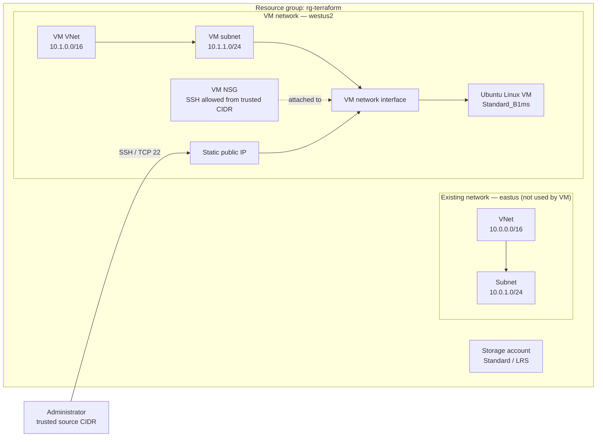

# Terraform Project: Azure Infrastructure

This project uses Terraform and the AzureRM provider to provision an Azure
resource group, storage account, virtual network, subnet, network security
group, public IP, and Ubuntu Linux virtual machine.

The original VNet and subnet remain in `eastus`. The VM uses a separate VNet
and subnet in `westus2` because Azure network resources must be in the same
region as the VM's network interface.

## Infrastructure

| Resource | Terraform name | Configuration |
| --- | --- | --- |
| Resource group | `azurerm_resource_group.rg` | `rg-terraform` in `eastus` |
| Storage account | `azurerm_storage_account.storage` | Standard performance, locally redundant storage |
| Existing network security group | `azurerm_network_security_group.nsg` | Remains in `eastus`; not attached to the VM |
| Existing virtual network and subnet | `azurerm_virtual_network.vnet`, `azurerm_subnet.subnet1` | Remain in `eastus`; not used by the VM |
| VM virtual network and subnet | `azurerm_virtual_network.vm`, `azurerm_subnet.vm` | `10.1.0.0/16` and `10.1.1.0/24` in `westus2` |
| VM network security group | `azurerm_network_security_group.vm` | Allows SSH only from the configured trusted source CIDR |
| Public IP | `azurerm_public_ip.vm` | Static Standard public IP in `westus2` |
| Linux virtual machine | `azurerm_linux_virtual_machine.vm` | Ubuntu Server 22.04 LTS Gen2 in `westus2`; size `Standard_B1ms` by default; SSH key authentication |

## Architecture diagram

This is the intended Terraform architecture. Azure VM capacity varies by
region, so the VM exists in Azure only after a successful `terraform apply`.



### Cost note

The Azure Retail Prices API lists Linux `Standard_B1ms` compute in `westus2` at
about **$0.0207/hour** (approximately **$15.11/month** for 730 hours). This is
only the VM compute estimate; managed disk, public IP, storage, network
transfer, taxes, and other subscription resources can add charges. Prices,
credits, and exchange rates vary, so this estimate does not guarantee that
total subscription spending will stay below €95/month or the remaining €140
credit. Azure budgets provide alerts, not a hard spending cap. Stop or destroy
the VM when it is not needed and review Azure Cost Management regularly.

## Prerequisites

1. An Azure subscription where you are allowed to create resources.
2. [Terraform](https://developer.hashicorp.com/terraform/install) installed.
3. [Azure CLI](https://learn.microsoft.com/cli/azure/install-azure-cli) installed.
4. An Azure account with permissions to create the resources in this project.

## Deploy the infrastructure

Run these commands from the directory containing `main.tf`.

### 1. Sign in to Azure

```shell
az login
```

Complete the browser sign-in and make sure the account has access to the
subscription configured for the AzureRM provider.

### 2. Create or locate an SSH key pair

If you do not already have an SSH key pair, create one locally:

```shell
ssh-keygen -t ed25519 -f ~/.ssh/terraform_azure
```

Keep the private key (`terraform_azure`) secure and do not commit it. Terraform
uses only the public key (`terraform_azure.pub`).

### 3. Set the VM inputs

Set the required inputs through environment variables so the public key and
trusted source CIDR do not need to be committed to the repository. Replace the
example values with your public key and your own public IPv4 address:

```powershell
$env:TF_VAR_ssh_public_key = Get-Content -Raw "$HOME\.ssh\terraform_azure.pub"
$env:TF_VAR_ssh_source_address_prefix = "203.0.113.10/32"
```

`203.0.113.10/32` is an example documentation address; replace it with your
actual trusted IP/CIDR. Do not use `0.0.0.0/0`, which would allow SSH attempts
from any IPv4 address. The VM administrator defaults to `azureuser`, and the
VM size and region default to `Standard_B1ms` and `westus2`. You may override
these with `TF_VAR_vm_admin_username`, `TF_VAR_vm_size`, and
`TF_VAR_vm_location`.

### 4. Format the Terraform files

```shell
terraform fmt
```

### 5. Initialize Terraform

```shell
terraform init
```

This downloads the AzureRM provider version specified by the configuration.

### 6. Check the configuration

```shell
terraform validate
```

Resolve any reported errors before continuing.

### 7. Review the proposed changes

```shell
terraform plan
```

Check the plan carefully. Terraform will create or change billable Azure
resources when you apply it.

### 8. Create or update the infrastructure

```shell
terraform apply
```

Review the plan shown by Terraform and enter `yes` only if you want to proceed.

After a successful apply, Terraform prints the VM's public IP address as
`vm_public_ip`. Connect using the matching private key:

```shell
ssh -i ~/.ssh/terraform_azure azureuser@<vm_public_ip>
```

On PowerShell, use the path to your private key, for example:

```powershell
ssh -i "$HOME\.ssh\terraform_azure" azureuser@<vm_public_ip>
```

### 9. Remove the infrastructure when it is no longer needed

```shell
terraform destroy
```

Review the proposed deletions and enter `yes` only if you want to remove the
managed resources. This deletes infrastructure and may delete data stored in
the storage account.

## Project files

- `main.tf` — AzureRM provider requirements, infrastructure resources, and VM
  inputs/output.
- `.terraform.lock.hcl` — locked provider selections for reproducible
  initialization.

Terraform state files can contain sensitive infrastructure details. Do not
publish or share them. For team use, configure a secured remote state backend
with access controls and state locking rather than relying on a local state
file.
